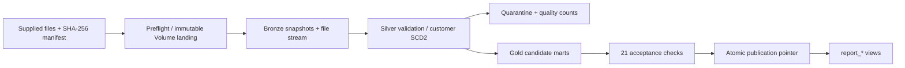

# ShopStream retail pipeline for Azure Databricks

A working implementation for the exact supplied synthetic retail dataset. The bundle deploys a five-task Lakeflow Job; every task is also an importable Python notebook. The original taxi template is retained under `src/`, but is excluded from this deployment.



## Run the deployed bundle

The configured Azure workspace is `https://adb-7405609019767524.4.azuredatabricks.net`. The selected CLI profile is `adb`.

```powershell
databricks bundle validate --strict --target dev --profile adb
databricks bundle deploy --target dev --profile adb
databricks bundle run shopstream_job --target dev --profile adb
```

Development schema: `wsadbnov.shopstream_dev_rk3924726` for the current identity. Production schema: `wsadbnov.shopstream_prod`. The catalog must already exist. The preflight creates the dedicated schema and managed Volume. Serverless STANDARD mode is used; the daily 02:00 Asia/Kolkata schedule is initially paused. No secrets are embedded in notebooks or configuration.

Do not deploy to production until the access controls, service principal, notification recipients, retention policy and operational ownership in [docs/OPERATIONS.md](docs/OPERATIONS.md) are configured for your organization. This is a synthetic-data implementation with enterprise engineering controls; it does not establish organization-specific compliance or availability guarantees.

## Import notebooks manually

Unzip `artifacts/shopstream_databricks_import.zip`. Import all `.ipynb` files under `ipynb/` into the **same Workspace folder**. Alternatively import the source notebooks from `notebooks/`. `_common` must remain beside the numbered notebooks.

Upload the entire bundled `data/` folder, including `manifest.json` and `contracts.json`, to Workspace Files or an existing Unity Catalog Volume. Azure Databricks cannot read the original Windows UNC path.

Open `00_run_all`, attach serverless or Unity Catalog compatible Databricks Runtime 16.4 LTS or newer, and set:

| Widget | Example |
|---|---|
| `catalog` | `wsadbnov` |
| `schema` | `shopstream_manual` |
| `volume` | `shopstream_landing` |
| `source_path` | `/Workspace/Users/your-user/shopstream/data` or `/Volumes/catalog/schema/input/data` |
| `max_reject_rate` | `0.10` |
| `dirty_reject_rate` | `0.65` |

Run all cells in `00_run_all`. It assigns one run ID and passes it to all stages. For standalone stage repair, use the original run ID and the same parameters. A new complete run must have a new run ID. Do not run manual and scheduled writers concurrently against the same schema.

## Dataset coverage

| Input | Silver processing | Reporting output |
|---|---|---|
| `customers.csv` | Required fields, email/status/date validation; optional age warning; missing city → Unknown | Customer current/history, with direct contact PII removed |
| `customer_updates_cdc.csv` | Ordered I/U/D lifecycle; retain base-only attributes; SCD2 intervals | Customer history and current |
| `products.csv` | Decimal price/cost and natural key validation | Product sales and estimated margin |
| `orders.csv` | Customer FK, event time, status, channel | Order summary; daily sales |
| `order_items.csv` | Order/product FK, positive quantity, fractional discount, line arithmetic | Product/day sales and order amounts |
| `payments.csv` | Order FK, decimal amount, status and timestamp | Payment reconciliation |
| `dirty_daily_sales.csv` | Mixed date formats, normalization, invalid numerics and duplicate quarantine | Cleaned daily sales, kept separate from June transactions |
| `inventory_snapshot.csv` | Product FK, nonnegative stock, composite snapshot key | Product stock across warehouses |
| `clickstream_nested.json` | Explicit nested schema, event/customer rules, array quantities, product FK | Daily devices; exploded item detail in Silver |
| `streaming_orders/*.json` | Available-now file stream, checkpoint, hash MERGE, event key validation | Daily event status/amount |
| `skew_sales.csv` | Transaction keys, decimal amounts | Regional totals via broadcast city lookup |
| `city_region_lookup.csv` | Unique city and required region | Region enrichment |

The streaming folder is included because it is part of the supplied dataset README. No external business data is used. The linked ChatGPT syllabus could not be accessed; syllabus-specific coverage has not been verified.

## Controls and semantics

- Exact headers, row counts, file sizes and SHA-256 hashes pin the supplied training release. Unexpected input is rejected before ingestion. Raw CSV strings and source lineage are preserved in Bronze.
- Batch files are **complete snapshots**, reprocessed for each new run. They are not presented as a general incremental feed. Customer history is reconstructed from the complete base plus supplied CDC. The stream alone uses a persistent incremental checkpoint.
- All Bronze/Silver/Gold batch tables carry `_run_id`; a retry replaces only that run. Old run snapshots remain available. Quarantine stores every rejected occurrence and raw values. Conflicting payloads at one natural key fail the run instead of choosing arbitrarily.
- Required keys, dimensions, dates, prices and quantities are never invented. Optional bad age becomes null with a warning; missing city becomes `Unknown`. Defaults and quality thresholds are explicit.
- Exactly 3 of the 8 dirty sales rows survive; 5 are quarantined, including one duplicate. The explicit dirty-source rejection allowance is 65%; other sources allow 10%. Tightening either threshold can deliberately block publication.
- Currency is decimal; discounts are fractions (0.10 = 10%). Supplied timestamps are interpreted as UTC; customer registration dates use day-month-year.
- One line-item aggregation and one payment aggregation occur **before** their order joins, preventing many-to-many amount multiplication.
- Booked sales excludes CANCELLED orders; delivered sales includes only DELIVERED. Successful payments are a separate metric. Failed/refunded payments can be uncollected and are not automatically classified as data defects. The current training release has one recorded payment per order and recorded amounts reconcile with item totals; the acceptance gate pins that release rule.
- Estimated margin uses the supplied current product cost. There is no historical-cost or accounting-recognition feed in these files. Customer history is available for as-of analysis; current customer attributes are not misrepresented as historical order attributes.
- Gold candidates remain invisible through `report_*` views until all checks pass. A single Delta pointer update publishes all candidate run IDs. Multi-query clients should read and pin one run ID for their session.
- The job serializes writers, retries tasks once and applies timeouts. Audit state contains no row-level PII. Quality, warnings, quarantine and acceptance checks are queryable Delta tables.

## Expected acceptance results

126 orders; 259 order items; 126 payments; 13 current customers and 17 customer versions; 25 streaming events; 3 clickstream events and 3 exploded items; 3 cleaned dirty-sales rows and 5 rejected occurrences. The publication notebook runs 21 financial, count, CDC, uniqueness and scenario acceptance checks.

```sql
SELECT * FROM wsadbnov.shopstream_dev_rk3924726.ops_publication;
SELECT * FROM wsadbnov.shopstream_dev_rk3924726.report_daily_sales ORDER BY order_date;
SELECT * FROM wsadbnov.shopstream_dev_rk3924726.ops_run_audit ORDER BY recorded_at;
SELECT * FROM wsadbnov.shopstream_dev_rk3924726.ops_acceptance_checks
WHERE _run_id = '<run_id>' AND NOT passed;
SELECT _errors, count(*) FROM wsadbnov.shopstream_dev_rk3924726.quarantine_dirty_daily_sales
WHERE _run_id = '<run_id>' GROUP BY _errors;
```

## Local checks and packaging

No Spark installation is needed for the independent release tests. Databricks executes the Spark integration and publication checks.

```powershell
python -m unittest discover -s tests -p test_shopstream_release.py -v
python tools/build_import.py
```

See [docs/OPERATIONS.md](docs/OPERATIONS.md) for recovery, grants, release management, retention and performance guidance. See `docs/VALIDATION.md` for the actual execution evidence from this implementation.
